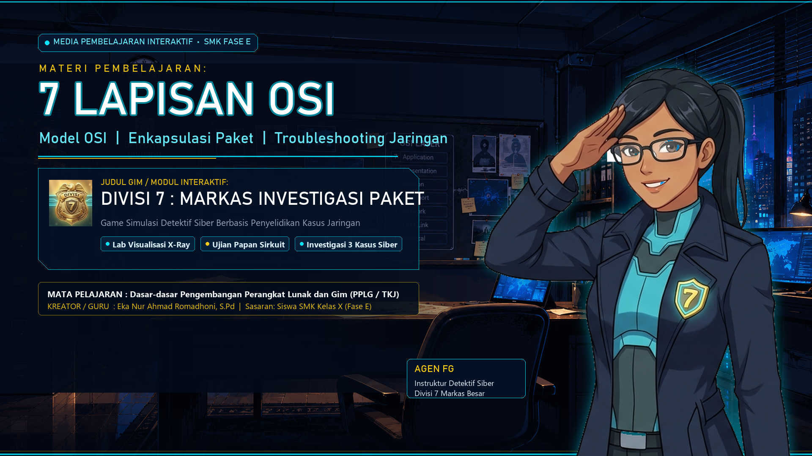

# 🕵️‍♂️ DIVISI 7 : Markas Investigasi Paket
> **Media Pembelajaran Interaktif: 7 Lapisan OSI (Open Systems Interconnection)**



---

## 📖 Tentang Proyek

Pernahkah kamu membayangkan bagaimana pesan *chat* atau panggilan video bisa meluncur melintasi internet hingga tiba di layarmu? Di **Divisi 7: Markas Investigasi Paket**, kamu akan mempelajari rahasia perjalanan data melalui **7 Lapisan OSI** secara tuntas dan mendalam.

Kamu tidak hanya sekadar membaca teori! Bersama pemandu detektif siber **Agen FG**, kamu akan merasakan sensasi menjadi detektif yang membedah paket data di Lab X-Ray, merakit sirkuit protokol, hingga memecahkan kasus insiden jaringan nyata di meja investigasi.

---

## 🎯 Fitur & Alur Pembelajaran

Game ini terbagi menjadi 5 ruang (*scene*) terintegrasi:

1. **Scene 1: Ruang Registrasi & Pengarahan Detektif**
   - Siswa memasukkan nama kadet dan memilih kode panggilan rahasia (*callsign*).
   - Pengenalan misi oleh Agen FG dengan narasi suara *voice-over*.
2. **Scene 2: Laboratorium Visualisasi Paket (X-Ray Scanner)**
   - Pembelajaran interaktif 7 Lapisan OSI dari Lapisan 7 (Application) hingga Lapisan 1 (Physical).
   - Mendukung dua skenario nyata: **Kasus Chat (TCP)** dan **Kasus Video Call (UDP)**.
   - Penjelasan detail proses **Enkapsulasi** (Pengirim) dan **Dekapsulasi** (Penerima) lengkap dengan perubahan PDU (*Data, Segment/Datagram, Packet, Frame, Bits*), header protokol, dan visualisasi animasi paket.
3. **Scene 3: Papan Ujian Kenaikan Tingkat Detektif**
   - Ujian pencocokan interaktif baris motherboard (*PDU & header matching*).
   - Fitur tombol *Acak Soal* dan *Periksa Jawaban* dengan indikator status pin.
   - Ambang kelulusan $\ge 80\%$ untuk membuka lisensi ke meja investigasi.
4. **Scene 4: Meja Investigasi Kasus Nyata**
   - Pemecahan 3 insiden jaringan bertingkat:
     - **Kasus K-01 (Tingkat Mudah)**: Kabel putus / port mati pada *Physical Layer*.
     - **Kasus K-02 (Tingkat Sedang)**: Salah *Default Gateway* pada *Network Layer*.
     - **Kasus K-03 (Tingkat Susah - Kejahatan Siber)**: Serangan *ARP Spoofing* pada *Data Link Layer*.
   - Fitur radio komunikasi bantuan petunjuk Agen FG.
   - Mini-puzzle tindakan perbaikan teknis.
5. **Scene 5: Ruang Pelantikan & Sertifikat Digital**
   - Tampilan piagam resmi penghargaan kehormatan Detektif Legendaris.
   - Fitur **Cetak / Ekspor Sertifikat** langsung ke format PDF/Print dengan cap stempel resmi Divisi 7.

---

## 🛠️ Teknologi yang Digunakan

- **Frontend**: HTML5 Semantic, CSS3 Modern (Cyberpunk Neon Theme, Glassmorphism HUD, Responsive 16:9 Aspect Ratio)
- **Logika & State**: Vanilla JavaScript (ES6+), Modular Game State Engine
- **Visual & Animasi**: HTML5 Canvas 2D (Latar 3D perspektif, lampu gantung dinamis, sorot cahaya volumetrik, dan partikel debu)
- **Audio Engine**: Web Audio API (Multi-mood BGM synthesizer, efek suara aksi, dan manajemen narasi suara *Voice Over* Agen FG)

---

## 🚀 Cara Menjalankan

1. Clone repositori ini:
   ```bash
   git clone https://github.com/ekanur/divisi-7.git
   ```
2. Buka folder proyek:
   ```bash
   cd divisi-7
   ```
3. Buka file `index.html` langsung di browser modern (Google Chrome, Microsoft Edge, Mozilla Firefox) atau gunakan ekstensi *Live Server* pada VS Code.

---

## 👤 Pengembang
- **Eka Nur Ahmad Romadhoni** ([@ekanur](https://github.com/ekanur))
- **Email**: eka.html@gmail.com
